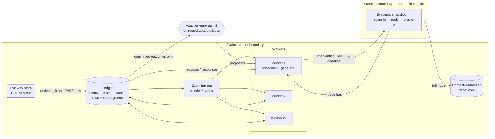
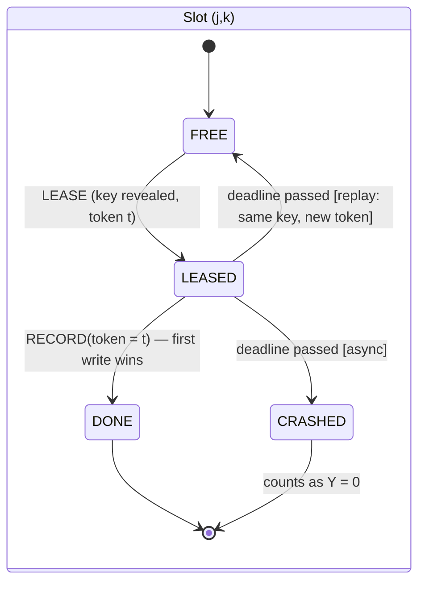
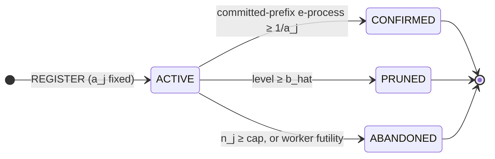
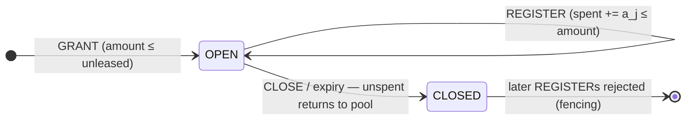
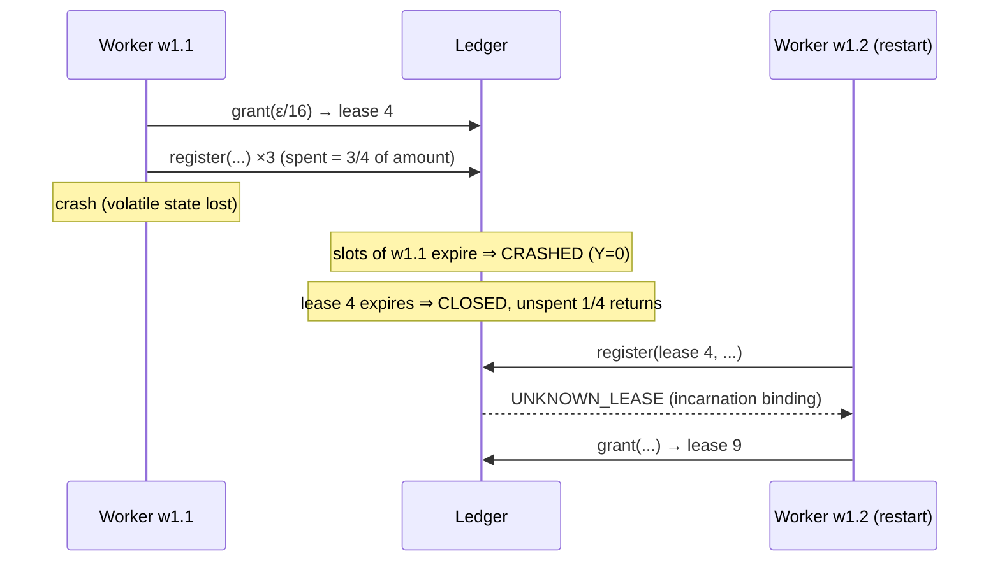
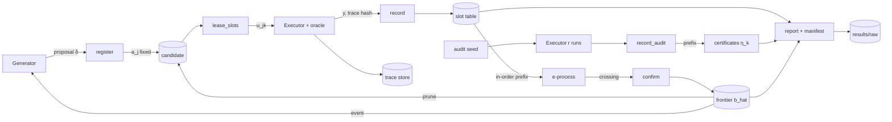

# Stage 3 — Distributed Architecture, Protocol, and Implementation

**Scope.** This stage covers the system design that realises FRESCO (Stage 2, §4): protocol messages and state machines, a failure-scenario analysis, persistence, a justification for every component, and the implementation plan. It also includes a working, tested implementation of the protocol core and a deterministic fault-injection simulator.

**Evidence status.** Section 9's numbers come from `sims/stage3_fault_injection.py`, which runs synthetic oracles through the *implemented* protocol. They test the protocol and the implementation, not LLM agents.

**What is built vs. specified:**

| Item | Status |
|---|---|
| Ledger state machine (`fresco/ledger.py`) | built, tested |
| Protocol messages (`fresco/messages.py`) | built, tested |
| Discrete-event simulator: network, workers, executors, ledger crash/recovery (`fresco/sim/`) | built, tested |
| Run manifests (`fresco/manifest.py`) | built |
| Extension interfaces (`fresco/interfaces.py`) | specified |
| PostgreSQL schema (`deploy/postgres_schema.sql`) | **specified, never executed** |
| Epoch (bit-reproducible) mode, offline-escrow reconciliation, real LLM executor | **not built** (Stage 4) |

Tests: 34 pass (`python3 -m pytest -q tests`).

---

## 1. Architecture

### 1.1 Components and trust boundaries

**Trust boundaries:**
- Workers and the ledger belong to the evaluator and are honest but crash-prone.
- The agent under test runs inside a per-slot sandbox built from an immutable snapshot.
- The generator receives only committed outcomes. It never sees a key before that slot is leased (A2).
- The oracle runs inside the sandbox but is evaluator code, versioned and hashed (A5).

### 1.2 Why each component exists, and what is deliberately absent
| Component | Problem it solves | Needed? |
|---|---|---|
| **Single linearizable ledger** | Theorem 8 needs a single serialisation point for four things: (i) Σ a_j ≤ ε (I1, I2); (ii) write-once slots with token fencing (I3); (iii) in-order commit (I4); (iv) confirmation by recomputation (R6). | **Yes.** Every safety property routes through it. |
| Write-ahead journal | Coordinator crash recovery without losing or double-applying transitions. Deterministic replay rebuilds identical state, which is tested by digest. | Yes |
| Request idempotency cache (sender, req_id) | Retransmissions caused by loss or slow responses must not double-register, double-spend, or double-lease. | Yes (CE1 at the request level) |
| PRF run key | Keys must be fresh and independent (A1), unpredictable before lease (A2), and reproducible for replay. | Yes |
| Event fan-out (frontier/status) | Workers stop work that has become useless. Losing or delaying it costs efficiency only (Proposition 10). | Optional. PostgreSQL LISTEN/NOTIFY or plain polling is enough |
| Content-addressed trace store | Audit and re-analysis: every result row points to its full trace by hash. | Yes, for reproducibility |
| PostgreSQL (production ledger) | Durable, serialisable transactions; unique keys enforce I3; CHECK constraints back I1–I2. | Yes, for real runs. SQLite would suffice on one machine |
| PostgreSQL synchronous replica + fenced failover | Ledger *availability* during long runs | **Only** if expected run length × coordinator failure rate makes downtime costly. Safety never needs it. A stopped ledger stops progress, not correctness |
| Kafka / message bus | — | **No.** At ≤ 10 writes/s (Stage 2 §7) a broker adds an at-least-once hop that must then be deduplicated, without solving any problem the ledger leaves open |
| Redis | — | **No.** A cache in front of the ledger would create the stale-read hazards that R6 avoids. Frontier staleness is already harmless |
| Kubernetes | — | Optional. Only as a convenient way to place executors and GPUs at scale. It has no protocol role |
| Consensus (Raft/Paxos) built by us | — | **No.** Use the replication of the database. The ledger is one logical writer |
| Blockchain / BFT | — | **No.** Workers belong to the evaluator, and the threat model has no Byzantine evaluator nodes (Stage 2 §8, item 7) |
| Ray | Placement of GPU executors across nodes | Optional (§6.3) |

---

## 2. Protocol

### 2.1 Messages (schema version 1; `fresco/messages.py`)
Every request carries `{kind, src, dst, req_id, body, v}`. `src` is the worker incarnation `"<name>.<n>"`. The ledger answers with `response{of, result}` and caches the answer per (src, req_id).

| Request (worker → ledger) | Body | Response `result` (ok case) | Failure reasons |
|---|---|---|---|
| `grant` | amount | lease_id, amount, expires | NO_BUDGET |
| `close_lease` | lease_id | ok | UNKNOWN_LEASE |
| `register` | lease_id, content, level | j, a_j | UNKNOWN_LEASE, LEASE_CLOSED, BAD_LEVEL, PRUNED, DUPLICATE_CONTENT(j) |
| `lease_slots` | j, count | grants: [{k, key, token}] | UNKNOWN, CONFIRMED, ABANDONED, PRUNED, CAP, BUDGET |
| `record` | j, k, y, token, trace_hash | ok | STALE_OR_DUPLICATE, UNKNOWN |
| `abandon` | j | ok | — |
| `lease_audit` | level | level, i, seed, keys[r], token | PRUNED, BUDGET |
| `record_audit` | level, i, z, token | ok | STALE_OR_DUPLICATE |

| Notification (ledger → workers) | Body | Semantics |
|---|---|---|
| `frontier` | b_hat, witness, seq | monotone min-register; delivered best-effort |
| `status` | j, status, seq | the candidate left ACTIVE; best-effort |

Reliability has two layers:
1. **Request layer:** retry until answered. Idempotency comes from the response cache.
2. **Evidence layer:** a slot result is accepted only if it matches the current lease token, and only once (first write wins).

Layer 2 is what makes Theorem 8 hold *even if* layer 1's cache is lost or bypassed. A replayed ledger rebuilds the cache, but correctness does not depend on it.

### 2.2 State machines



An audit draw follows the slot machine with z in place of y. A crash gives z = 1, and only the in-order prefix per level is counted.

### 2.3 Sequence diagrams
**Normal slot; duplicate and retry**
```mermaid
sequenceDiagram
  participant W as Worker w0.1
  participant L as Ledger
  participant X as Executor
  W->>L: lease_slots(j, 2) [req 17]
  L-->>W: grants (k=5,u5,t5), (k=6,u6,t6)
  W->>X: run(δ_j, u5) / run(δ_j, u6)
  X-->>W: y6 = 1 (fast)
  W->>L: record(j,6,1,t6) [req 18]
  Note over L: slot 6 DONE; prefix waits for slot 5 (in-order)
  X-->>W: y5 = 0
  W->>L: record(j,5,0,t5) [req 19]
  Note over L: commit 5 then 6; update E_j
  L--xW: response to req 19 lost
  W->>L: record(j,5,0,t5) [req 19 retry]
  L-->>W: cached response (no second update)
```
**Executor crash, async mode compared with replay mode**
```mermaid
sequenceDiagram
  participant W as Worker
  participant L as Ledger
  participant X as Executor
  W->>L: lease_slots(j,1)
  L-->>W: (k=7, u7, t7)
  W->>X: run(δ_j, u7)
  X--xW: crash / timeout (no result)
  Note over L: tick: now > t0 + slot_ttl
  alt async
    Note over L: slot 7 CRASHED ⇒ Y = 0 (R4); prefix advances
  else replay
    Note over L: slot 7 FREE, same key u7, new token t7'
    W->>L: lease_slots(j,1)
    L-->>W: (k=7, u7, t7')
    X-->>W: y7 (identical potential outcome)
  end
  X-->>W: late result for t7 (if any)
  W->>L: record(j,7,y,t7)
  L-->>W: STALE_OR_DUPLICATE (fenced)
```
**Worker crash and lease reclaim**

**Ledger crash and recovery**
```mermaid
sequenceDiagram
  participant W as Workers
  participant L as Ledger
  participant J as Durable journal
  W->>L: requests
  L->>J: append op (before applying)
  Note over L: crash; volatile state lost
  W--xL: requests time out; retried with same req_id
  L->>J: recover: replay all ops
  Note over L: digest(state) == pre-crash digest (checked)
  W->>L: retried requests ⇒ cached responses or fresh transitions
```
**Partition.** Workers cut off from the ledger keep retrying. Their slots expire and are imputed conservatively. Their budget leases expire and are reclaimed. When the partition heals, their late results are fenced off. Safety is unaffected; the cost is wasted executions.

### 2.4 Data flow


### 2.5 Certificate refinement found while building the simulator — *proved*
The Stage 2 certificate uses Z = 1{any of r runs violates}. Nulls with p just below α trip it often, so η is valid but **vacuous**. The first simulated run gave η ≈ 0.58–0.88 on levels whose true μ is 0.

**Generalisation.** Let $Z = \mathbf{1}\{\#\text{violations in } r \text{ runs} \ge t\}$ and choose a certified level $\alpha_c \ge \alpha$. The binomial tail $P(\mathrm{Bin}(r,p) \ge t)$ is increasing in $p$. So every draw with $p \ge \alpha_c$ has $P(Z=1) \ge h := P(\mathrm{Bin}(r,\alpha_c) \ge t)$, which gives

$$\mu_k(\alpha_c) = D_k\{p \ge \alpha_c\} \le U_k / h.$$

The anytime validity of $U_k$ (Propositions 2 and 3) carries over unchanged. The trade-off: $t = 1$ maximises $h$ but admits null noise. Larger $t$ suppresses nulls (for r = 10, t = 4, a null with p = 0.1 trips Z with probability 0.013) but shrinks $h$ (0.121 at $\alpha_c = 0.2$; 0.618 at $\alpha_c = 0.4$). In the simulator, $(r, t, \alpha_c) = (10, 4, 0.4)$ gives η ≈ 0.20 on null levels after about 100 audits, compared with η = 1.0 (vacuous) for $(10, 4, 0.2)$.

**Conclusion.** Informative certificates need a **certified gap** $\alpha_c > \alpha$ or thousands of audits. This is now a reported parameter (`audit_level`, `audit_threshold`) and must be preregistered.

### 2.6 Deadlines are part of the statistics
Conservative imputation (R4) turns every timeout into evidence *against* the conclusion being drawn. A slot that times out counts as non-violating for confirmation and as violating for audits. The simulator exposed a bug of exactly this kind. Audit draws run r episodes back to back, but the deadline was sized for one episode, so every r = 10 audit "crashed" and counted as a hit. The audit deadline is now `slot_ttl × r`.

**Operational rule.** Set the deadline at least at the 99.9th percentile of episode latency, measured separately for violating and benign trajectories in a pilot. Report the imputation rate per arm.

---

## 3. Failure-scenario evaluation

| Scenario | Mechanism | Safety (G1/G2) | Liveness | Efficiency cost | Tested by |
|---|---|---|---|---|---|
| Message loss | sender retries the same req_id | holds | yes | retry latency | `test_survives_combined_faults` |
| Message duplication or reordering | request cache plus write-once token | holds | yes | none | `test_write_once_and_token_fencing`, `test_unsafe_no_dedup_applies_duplicates`, §9 |
| Results arrive out of order | in-order prefix commit | holds | yes | head-of-line ≤ slot_ttl | `test_in_order_commit`, §9 |
| Executor crash or timeout | async: Y=0 / Z=1; replay: same key | holds | yes | lost power (async) | `test_async_crash_is_zero_and_late_result_ignored`, `test_replay_mode_reuses_key_with_new_token`, §9 |
| Outcome-correlated timeouts | conservative imputation, no fresh retry | holds | yes | violations become harder to confirm (Stage 2 §8, item 2) | §9 (R4 pair) |
| Worker crash or restart | slots expire; lease bound to incarnation; reclaimed on expiry | holds | yes | in-flight work lost | `test_lease_fencing`, `test_survives_combined_faults` |
| Zombie worker (old incarnation) | lease and slot tokens fenced | holds | — | — | `test_lease_fencing` |
| Network partition, worker side | retries; expiry; reclaim | holds | after heal | wasted executions | `test_survives_combined_faults` |
| Ledger crash | WAL journal replay, digest-checked | holds | after recovery | downtime | `test_journal_recovery_reproduces_state`, `test_survives_combined_faults` |
| Ledger disk loss | — | **lost** (no replica) | no | run restart | not covered: needs DB replication (§1.2) |
| Clock skew between workers | all deadlines evaluated on the ledger's clock | holds | yes | — | by construction |
| Stale frontier | ledger is authoritative | holds | yes | ≤ K·W·θ·Δ (Proposition 10) | §9 (waste column) |
| Elastic membership | budget only through ledger leases | holds | yes | — | §9 (R5 pair) |
| Non-deterministic "seeded" model | replay audit mismatch ⇒ fall back to async | holds after fallback | yes | power | **not yet built** (Stage 4) |
| Hidden state across slots | **violates A1**; not protocol-recoverable | **can fail** | — | — | diagnostic only (runs test, Stage 4) |

---

## 4. Consistency and replication
The ledger is **one logical writer** with linearizable, serialisable transitions. Two realisations:
1. **Single node.** SQLite or PostgreSQL with a write-ahead log on local disk. Safety is complete. A crash causes downtime, and recovery is replay (already implemented for the in-memory ledger).
2. **Highly available.** PostgreSQL with one synchronous standby and fenced failover. The promoted primary bumps a ledger epoch. Workers attach the epoch to every request, and stale-epoch requests are rejected. This prevents split-brain double grants. It is needed only when downtime is expensive, because safety never depends on availability.

Workers hold no authoritative state. Their local view of candidates, frontier and in-flight slots is a soft cache. After a crash the ledger's state is the full truth, which is why recovery needs no worker coordination.

---

## 5. Persistence and experiment logging
- **Ledger tables** (`deploy/postgres_schema.sql`): run, budget_lease, candidate, slot (PK (run, j, k) ⇒ I3), audit_draw, audit_level, request_cache, journal, event. CHECK constraints back I1–I2.
- **Trace store.** Full episode traces (tool calls, post-state hash, oracle verdict) are stored by content hash. Slot rows hold only `trace_hash`.
- **Result rows.** One per scenario × model × surface × generator × configuration. Each row carries `b_hat`, the witness trace hash, η per level with (r, t, α_c), slots, registrations, imputation counts per arm, the config hash, the code revision, and the run-key commitment `SHA256(κ)` (the key itself is disclosed after the run, so every u_jk can be verified). This extends manuscript Appendix A.
- **Manifests** (`fresco/manifest.py`): config hash, seed, code revision with a dirty flag, Python/NumPy versions, and platform.

---

## 6. Implementation design

### 6.1 Repository layout
```
fresco/
  eprocess.py       betting e-process, Kelly, Wald bound          (Stage 2)
  spending.py       budget ledger model                           (Stage 2)
  certificates.py   zero-failure bound, betting CS, threshold mass bound
  lexis.py          single-process LEXIS                          (Stage 2)
  ledger.py         FRESCO ledger state machine, R1–R6, journal, invariants
  messages.py       protocol schema v1
  interfaces.py     Executor / Generator / Scheduler protocols
  manifest.py       run manifests, config hashing
  sim/
    engine.py       deterministic discrete-event engine, named RNG streams
    network.py      delay, loss, duplication, reordering, partitions
    scenario.py     synthetic reservoirs with ground truth; outcome-correlated latency/crash
    nodes.py        LedgerNode (crash + journal recovery), Worker (scheduler, RPC with retry)
    run.py          simulate(SimConfig) -> metrics with ground truth
deploy/postgres_schema.sql   production ledger schema (specification)
sims/                        Monte Carlo checks per stage, with committed outputs
tests/                       unit, property, integration, failure-injection tests
docs/                        stage documents
```
**Planned for Stage 4:** `fresco/runtime/` (real multi-process runner and ledger service), `fresco/adapters/` (MARGIN-Bench executor for open-weight models), `experiments/` (configs and runners), `analysis/` (statistics and figures).

### 6.2 Interfaces (`fresco/interfaces.py`)
- **`Executor.execute(scenario_id, intervention, key, deadline)`** returns a `SlotResult` or `None` on crash. It must start from the immutable snapshot and reset every piece of persistent state (A1).
- **`Generator.propose(level, history)`** receives only committed outcomes. **`Generator.audit_draw(level, seed)`** is a pure function of the ledger seed (I9).
- **`Scheduler.next_action(view)`**: any policy is valid (Theorem 1).

### 6.3 Runtime choice for real experiments (Stage 4)
- **Default:** one ledger process (SQLite, or PostgreSQL for multi-host) and W worker processes speaking the same JSON messages over HTTP (FastAPI) or a local socket. Executors run open-weight models through vLLM or HF with fixed sampling seeds. This is enough for W ≤ 32 on one or two GPU nodes. Messages are about 200 B at ≤ 10/s, so gRPC is not needed.
- **Ray** is used only if executors have to be placed on many GPU nodes, and only as a *placement* layer. Ray's task retries must be **disabled** for slot execution: they implement exactly the fresh-retry pattern that Theorem 9 (CE2) rules out.

---

## 7. Reproducibility controls
- **Deterministic simulator.** Named SHA-256-derived RNG streams and sequence-numbered event ties. `trace_digest` is identical across runs (`test_simulation_is_deterministic`).
- **Run key commitment.** Publish $\mathrm{SHA256}(\kappa)$ before the run and reveal κ afterwards. Anyone can then recompute every slot key and check that results match traces.
- **Journal.** The complete, replayable record of every transition. `Ledger.recover` reproduces the final state and digest.
- **Config hash and manifest** on every result row. Pinned dependencies and container images for real runs (Stage 4).
- **Epoch mode** (Proposition 13) gives bit-identical output across W with seeded executors. It is **not yet implemented**.

## 8. Test specification

| Group | Tests (file) | Property |
|---|---|---|
| Statistical core | `tests/test_core.py` (14) | bet range, prefix-only bets, Kelly = KL, spending sum, budget invariants, certificates, LEXIS determinism and pruning |
| Ledger transitions | `tests/test_ledger.py` | confirmation and pruning; request idempotency (no double spend); write-once and token fencing; in-order commit; async crash ⇒ 0 and late results fenced; replay reuses the key; the unsafe fresh-retry flag changes the key; PRF keys; lease fencing (incarnation, expiry, close) with full reclaim; content dedup; audit prefix and conservative expiry; message round-trip and validation |
| Property-based | `test_random_operation_sequences_keep_invariants` (async and replay) | I1–I7 after every one of 600 random operations × 5 seeds |
| Recovery | `test_journal_recovery_reproduces_state` | the replayed digest and report are identical |
| Simulation integration | `tests/test_sim.py` | determinism; recovers the true margin without faults; combined faults (loss, duplication, partition, worker crashes, two ledger crashes, executor crashes) keep invariants, give exact recovery, and produce no false confirmation; duplicates applied only when the rule is removed |
| System fault injection (Monte Carlo) | `sims/stage3_fault_injection.py` | §9 |
| **Planned** | PostgreSQL adapter conformance (the same transition tests against the DB); epoch-mode bit-reproducibility across W; real-executor replay-determinism audit | Stage 4 |

## 9. System-level fault injection (synthetic; `sims/stage3_fault_injection.out.txt`)
**Setup.** All candidates at all levels are nulls at the boundary p = α = 0.2, so every confirmation is false. ε = 0.05. Each configuration runs 400 independent seeds with a 3,000-slot budget (6,000 for W = 8). Each unsafe variant removes **one** rule under the same fault trigger as its FRESCO pair.

Numbers below are from the **Stage 4 rerun** on the updated ledger, which uses the polynomial lease policy and incremental lease tracking (see the Stage 4 doc, §0). The original Stage 3 run, under the earlier lease policy, gave FRESCO 0.007–0.022 and removed-rule rates of 0.117–0.165, with the same qualitative conclusion.

| Configuration (fault trigger) | FRESCO, all rules | Same trigger, one rule removed |
|---|---|---|
| Clean (no faults) | 0.018 [0.009, 0.036] | — |
| **All faults combined**: 10% loss, 20% duplication, 800 s partition of 2/4 workers, worker crashes (1 per 2,000 s each), 2 ledger crashes, executor crashes 0.3 / 0.1 (benign / violating), violations 3× faster, 8 slots in flight | **0.003 [0.000, 0.014]** | — |
| Network duplication 0.3 → remove dedup (R3) | 0.013 [0.005, 0.029] | **0.133 [0.103, 0.169]** |
| Outcome-correlated crashes 0.3 / 0.1 → allow fresh-key retry (R4) | 0.010 [0.004, 0.025] | **0.102 [0.076, 0.136]** |
| Violations 6× faster, 8 in flight → consume in arrival order (R3) | 0.018 [0.009, 0.036] | **0.083 [0.059, 0.114]** |
| W = 8 workers → worker-local budget (R5) | 0.018 [0.009, 0.036] | 0.065 [0.045, 0.094] |

Entries are P(any false confirmation) with 95% Wilson intervals, 400 seeds each.

**Reading.**
- With all rules, the implemented protocol keeps the false-confirmation probability below ε = 0.05 in every configuration, with upper confidence limits ≤ 0.036.
- Removing dedup, the fresh-retry ban, or in-order commit raises it to 0.083–0.133. For each of these the lower confidence limit is above ε.
- Removing the global budget (R5) at W = 8 gives 0.065, but the interval [0.045, 0.094] still contains ε. **At this configuration the inflation from R5 is not established.** Theorem 9 predicts it grows with W (FWER ≈ 1 − (1 − ε₀)^W). The Stage 1 abstract check showed 0.27 at W = 8 under worst-case thresholds, but realistic per-candidate thresholds make each worker's own error small.
- These are *system-level* reproductions of the Theorem 9 counterexamples through the real ledger, network, and worker code.

**What this does not show.**
- The fault rates are chosen triggers, not measurements. Effect sizes in a real harness depend on its actual duplicate, crash and latency profiles (hypothesis H-valid, Stage 4).
- All configurations share seeds 1000–1399. Rows are paired by design, although faults change the trajectory, so the runs are not identical.
- Where FRESCO rates coincide across rows (e.g. 0.018 = 7/400), the runs themselves differ (distinct ledger digests and registration counts). The coincidence comes from small counts.

## 10. What building the system taught us (corrections and open issues)
1. **Certificates need a gap** (§2.5). Without $\alpha_c > \alpha$, η is valid but vacuous whenever nulls sit near α.
2. **Deadlines are statistical parameters** (§2.6). They must be preregistered and reported.
3. **How budget is split shapes power.** Lease size and rotation fix the $a_j$ schedule, and therefore the thresholds. Small leases protect against budget lost to crashed incarnations but raise thresholds. This is an efficiency trade-off to sweep in Stage 4; validity holds for any setting.
4. **The size of the effects at system level depends on the regime.** The Stage 2 counterexamples are worst cases. At realistic thresholds ($\log(1/a_j)$ of about 4–7 nats), removing a rule inflates errors by smaller absolute amounts (§9). The argument for the rules is that they cost nearly nothing and remove a failure mode with no upper bound (error → 1 in the limits of Theorem 9). The claim is **not** that naive systems are always badly wrong.
5. **Not built yet:** epoch mode, offline escrow, PostgreSQL adapter, real executor, drift sentinel, replay-determinism audit.

## 11. Inputs to Stage 4
- Experiment configurations covering W ∈ {1, 2, 4, 8, 16, 32}, the baselines (Algorithm 1, independent ε/W runs, naive distributed, ASHA-style, centralised queue), and the hypotheses H-valid, H-coop, H-speed and H-vs-Alg1.
- Realistic latency and crash profiles measured in a small real-agent pilot.
- An adaptive generator interface.
- Statistical analysis scripts and figure generation.
