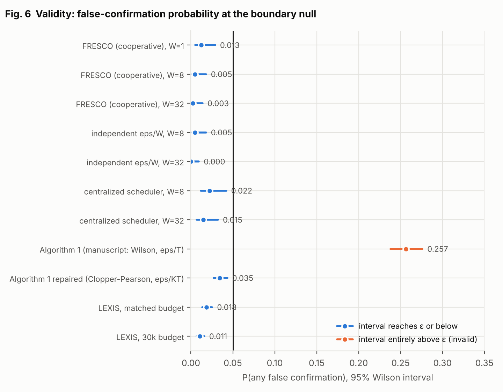
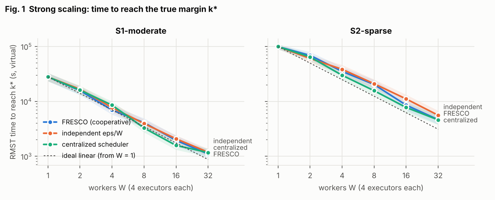
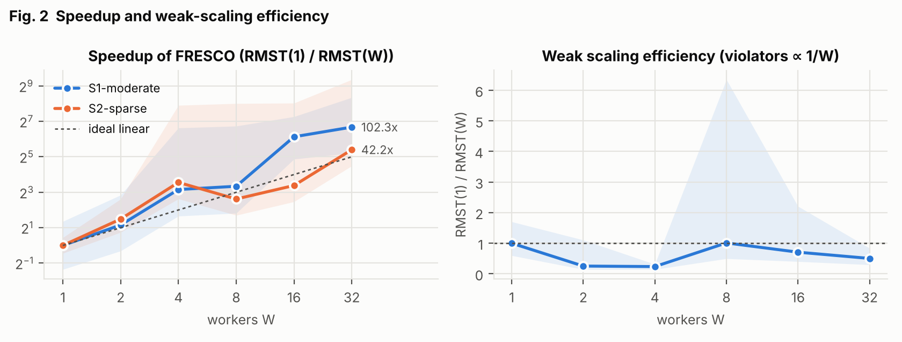
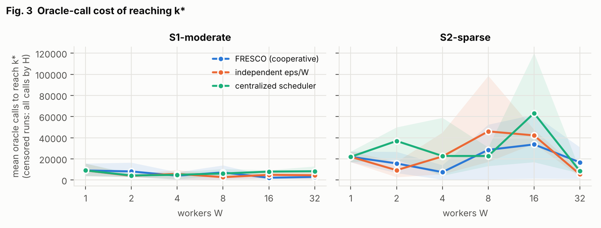
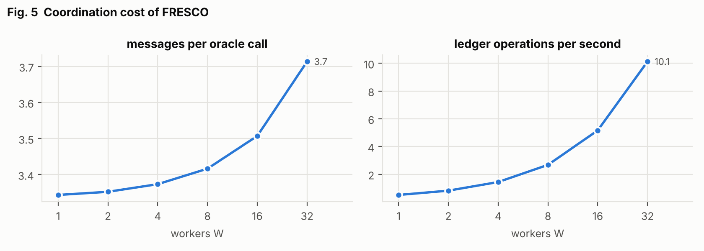
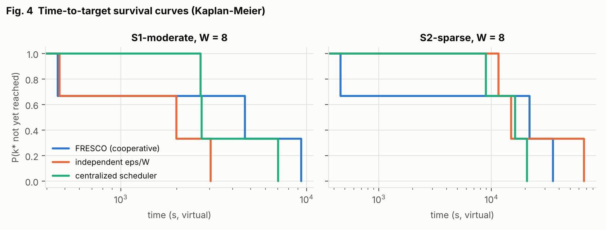
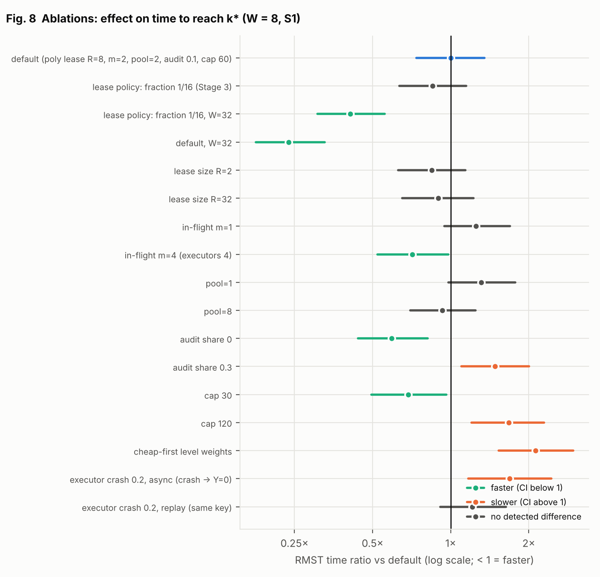
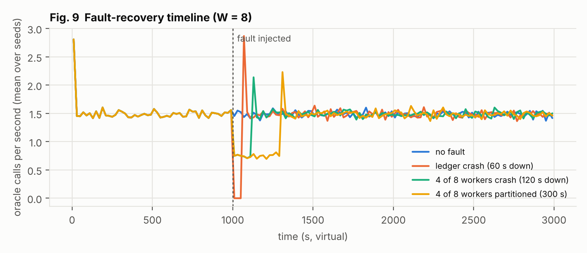

# Stage 4 — Simulations, Experiments, Benchmark Design, and Validation

**Scope.** This stage contains the preregistered hypotheses and decision rules, the baselines, the synthetic experiment suite (E1–E7) with results and figures, the statistical methods, and the exact protocol for the real-agent experiments, which have not yet been run.

**Evidence labels:**
- **[SYNTHETIC]** results come from the deterministic simulator of Stage 3 with Bernoulli oracles of known ground truth. They test the algorithm and the system, not LLM agents.
- **[TO RUN]** marks cells that require real agents and models. No value is supplied for them, and none is extrapolated.

Every number in §6 is produced by `analysis/make_figures.py` from `results/raw/*.jsonl`. The full suite reruns with `experiments/run_all.sh` (about 1.5–2 h on 4 cores).

---

## 0. Changes forced by building Stage 4

1. **Budget-lease policy (Stage 3 defect).** The Stage 3 policy granted a fixed fraction (1/16) of ε per lease and spent polynomially within each lease. At W = 32 only 16 leases could ever be granted, so half the workers starved, and the centralized variant's leases shrank geometrically. The first scaling smoke test showed it: cooperative W = 32 was *slower* than W = 8. It is replaced by a **polynomial lease schedule**: lease n receives ε/(n(n+1)), split evenly over R registrations. It never exhausts, and Σ ≤ ε by construction (`test_poly_lease_schedule_never_exhausts_and_sums_below_eps`). The old policy is kept as ablation E5. Validity is unaffected, because Theorem 8 holds for any spending rule with Σ ≤ ε.
2. **Algorithm 1 is invalid as specified.** See E4.
3. **Ledger performance.** The tick now scans only leased slots. This gave a 3× simulator speed-up and is required for W = 32 runs. Stage 3's fault-injection experiment was rerun on the updated ledger (§6.8).

---

## 1. Preregistered hypotheses and decision rules

These were fixed after a 3-seed pilot of E2 only (needed to size runs and horizons) and before any full run. α_test = 0.05, with the Holm correction inside each hypothesis family.

| ID | Hypothesis | Test / estimate | Supported if | Refuted if |
|---|---|---|---|---|
| H-valid-sim | Every FRESCO configuration keeps P(false confirmation) ≤ ε = 0.05 on the boundary null, including under faults | Wilson 95% interval per configuration (E1, Stage 3 rerun) | lower bound ≤ 0.05 in **all** configurations | any lower bound > 0.05 |
| H-rules | Removing any single rule raises the false-confirmation rate above ε under its trigger | Wilson interval (Stage 3 rerun) | lower bound > 0.05 for each removed rule | otherwise (reported per rule) |
| H-alg1 | Algorithm 1 as specified (Wilson, ε/T) exceeds ε on the boundary null; the repaired variant (Clopper–Pearson, ε/KT) does not | Wilson interval (E4) | as stated | as stated |
| H-vs-Alg1 | At a matched oracle budget, LEXIS reaches k* at least as often as repaired Algorithm 1 | difference in P(reach k*), Wilson intervals (E4) | LEXIS interval not below Algorithm 1's | LEXIS significantly lower |
| H-speed | FRESCO time-to-k* falls with W; parallel efficiency at W = 32 ≥ 0.5 (strong scaling, RMST ratio) | bootstrap CI of RMST(1)/RMST(W) | CI lower bound at W = 32 ≥ 16 | CI upper bound < 16 |
| H-coop | At equal total ε and equal total executors, cooperative FRESCO reaches k* faster than (a) W independent ε/W runs and (b) one centralized scheduler | two-sided Mann–Whitney on censored time, Holm over 20 comparisons; RMST ratio and rank-biserial as effect sizes | Holm-p < 0.05 with ratio < 1 for most W ≥ 8 | no detected difference (reported as such, not as equivalence), or FRESCO slower |
| H-overhead | Coordination is negligible relative to LLM-scale slot times | messages per oracle call; ledger ops/s at W = 32 (E2) | ≤ 10 messages per call; ledger load ≤ 100 ops/s | otherwise |
| H-recover | After a ledger crash, worker crash or partition, throughput returns to ≥ 90% of its pre-fault level within 2 × outage duration | E6 timelines | as stated | as stated |
| H-cert | Level certificates cover: P(η_k ≥ μ_k ∀k) ≥ 0.95 | Wilson interval (E7) | lower bound ≥ 0.90 and point estimate ≥ 0.95 | point estimate < 0.95 |

A "no detected difference" result is never reported as equivalence. All negative results are reported.

---

## 2. Workloads (synthetic)

| Name | Levels 1–4: fraction of true violators π (p_good = 0.6) | k* | Use |
|---|---|---|---|
| S1-moderate | 0, 0, 0.05, 0.10 | 3 | strong scaling, H-coop, ablations, recovery |
| S2-sparse | 0, 0, 0.01, 0.05 | 3 | strong scaling and H-coop on a harder search |
| Weak(W) | 0, 0, 0.16/W, 0 | 3 | weak scaling: expected search work ∝ W |
| Null-boundary | every candidate p = α = 0.2 | — | validity (every confirmation is false) |
| Cert | 0.003 (p = 0.3), 0.01 (p = 0.3), 0, 0 | — | certificate coverage (μ > 0 but hard to confirm) |

- **Nulls.** Null candidates have p ~ U(0, 0.2), or exactly α in the boundary instances.
- **Latency.** Slot latency is lognormal (σ = 0.5) with mean 20 s if benign and 30 s if violating. This is the order of magnitude of a tool-using agent episode, but it is not a measurement.
- **Capacity.** Each worker has 4 executors, so every method compares at a total of 4W concurrent oracle calls.
- **Censoring.** Time is censored at H = 150,000 s of virtual time.

**Why synthetic.** The validity claims concern *any* stochastic oracle, so known ground truth (which candidates are null, μ_k, k*) is what makes coverage measurable. Real-agent runs (§8) can measure efficiency and fault profiles but never coverage, because the true p is unknown.

## 3. Baselines

| ID | Baseline | Implementation | Valid? |
|---|---|---|---|
| B0a | Manuscript Algorithm 1 as written: per-budget top-T confirmation, Wilson bound at ε/T | `fresco/baselines/alg1.py` (`wilson-T`) | **no** (E4) |
| B0b | Algorithm 1 repaired: Clopper–Pearson at ε/(KT) | `cp-KT` | yes, by a union bound |
| B1 | W independent single-worker FRESCO deployments, each with its own ledger, budget ε/W and 4 executors; combined b̂ = min over runs | `simulate_independent` | yes, by a union bound |
| B2 | Naive distributed: FRESCO with one rule removed (no dedup / fresh retry / arrival order / local budget) | `LedgerConfig.unsafe_*` | no (Stage 3, rerun §6.8) |
| B3 | Centralized scheduler: one worker process driving all 4W executors through the same ledger | `centralized()` | yes |
| B4 | ASHA-style successive-halving scheduler | **not implemented**. Any scheduler is valid under Theorem 1, so ASHA belongs in the scheduler ablations; it is left as future work | — |

## 4. Metrics
- **Time to target:** virtual time until b̂ = k* first holds. Censored at H.
- **Oracle calls to target:** calls leased up to that moment, or all calls by H if censored.
- **P(reach k* by H)**, and **P(any false confirmation)**.
- **Coordination:** messages per oracle call, and ledger operations per second.
- **Recovery:** time after the fault ends until throughput is back to 90% of the pre-fault mean; calls lost.
- **Certificates:** coverage P(η_k ≥ μ_k ∀k), and median η_k.

## 5. Statistical methods
- **Unit of analysis.** The independent run (seed). Seeds index common random numbers across methods: the same seed gives the same per-worker generator streams. Faults change trajectories, so runs are compared as independent samples, not as paired observations.
- **Censoring.** All runs share the administrative horizon H, so comparisons use the **RMST**, the mean of min(T, H). It is unbiased for the restricted mean and needs no assumption about the censored tail. Kaplan–Meier curves are used for display.
- **Intervals.** Percentile bootstrap with 4,000 resamples for means and ratios. Wilson intervals for proportions.
- **Tests.** Two-sided Mann–Whitney U with tie correction. Censored values are ties at H, which is valid under common censoring. Holm adjustment within each hypothesis family.
- **Effect sizes.** RMST ratio with CI, and rank-biserial correlation (+1 means FRESCO is always faster).
- **Validity claims** use the Wilson lower bound against ε, which is conservative toward rejecting validity.
- **Power.** With 100 seeds per cell and the heavy-tailed (roughly geometric) times seen in the pilot (coefficient of variation ≈ 1), a two-sample test has about 80% power to detect an RMST ratio of about 0.65. Smaller cooperative gains would go undetected, and the report says so where it applies.

---

## 6. Results [SYNTHETIC]

The complete tables, with every interval, are in `results/processed/summary.md`. This section reports the headline numbers.

### 6.1 E1/E4 — validity on the boundary null (Fig. 6)
| Method | P(false confirmation) [95% Wilson] | Valid at ε = 0.05? |
|---|---|---|
| FRESCO, W = 1 / 8 / 32 | 0.013 [0.005, 0.029] / 0.005 [0.001, 0.018] / 0.003 [0.000, 0.014] | yes |
| Independent ε/W, W = 8 / 32 | 0.005 [0.001, 0.018] / 0.000 [0.000, 0.010] | yes |
| Centralized scheduler, W = 8 / 32 | 0.022 [0.012, 0.042] / 0.015 [0.007, 0.032] | yes |
| **Algorithm 1 as specified** (Wilson, ε/T) | **0.257 [0.238, 0.276]** | **no: 5.1× nominal** |
| Algorithm 1 repaired (Clopper–Pearson, ε/KT) | 0.035 [0.027, 0.043] | yes |
| LEXIS (1,160-slot / 30k budget) | 0.018 [0.013, 0.025] / 0.011 [0.007, 0.016] | yes |



**Reading.** Every method built on the ledger is valid, at every W. The manuscript's Algorithm 1 is not. It runs K = 4 sequential budget levels, each tested at ε/T, so it lacks a correction across levels (error up to Kε). Its Wilson bound is also anti-conservative at n = 30. The repair costs no efficiency (§6.4). **This is a concrete correction the original MARGIN-Bench manuscript needs.**

### 6.2 Stage 3 rule ablations, rerun (H-rules)
FRESCO stayed between 0.003 and 0.018 in every fault configuration. Removing one rule gave:

| Rule removed | P(false confirmation) [95% Wilson] |
|---|---|
| Deduplication | 0.133 [0.103, 0.169] |
| Fresh-key retry ban | 0.102 [0.076, 0.136] |
| In-order commit | 0.083 [0.059, 0.114] |
| Global budget (W = 8) | 0.065 [0.045, 0.094] |

The first three clear the preregistered criterion (lower bound > ε). **Removing the global budget does not**: at W = 8 its interval contains ε. Details are in the Stage 3 doc, §9.

### 6.3 E2/E3 — strong and weak scaling, coordination cost (Figs 1–5)
| | W = 1 | 2 | 4 | 8 | 16 | 32 |
|---|---|---|---|---|---|---|
| S1 RMST time to k* (s) | 27,955 | 15,733 | 6,961 | 4,103 | 1,954 | 1,101 |
| S1 speedup | 1 | 1.8 | 4.0 | 6.8 | 14.3 | **25.4** |
| S2 RMST time to k* (s) | 99,480† | 68,768 | 35,230 | 20,274 | 8,556 | 4,653 |
| S2 P(reach k* by H) | 0.62 | 0.83 | 0.98 | 1.00 | 1.00 | 1.00 |
| S1 mean oracle calls to k* | 5,184 | 5,838 | 5,177 | 6,108 | 5,850 | 6,628 |
| Messages per oracle call | 3.34 | 3.35 | 3.37 | 3.42 | 3.51 | 3.71 |
| Ledger ops/s (virtual) | 0.51 | 0.82 | 1.44 | 2.68 | 5.16 | 10.1 |
| Weak-scaling efficiency | 1 | 0.86 | 0.81 | 0.92 | 0.97 | 0.71 [0.53, 0.96] |

†38% of the W = 1 runs on S2 are censored at H, so the S2 speedup (21.4× at W = 32) is a lower bound.






**Reading:**
- **Strong scaling.** Parallel efficiency at W = 32 is 0.79 on S1, and the CI lower bound clears the preregistered threshold of 16×.
- **Oracle calls.** Calls to reach k* are roughly flat in W: 5.2k at W = 1 and 6.6k at W = 32 (+28%, overlapping CIs). Overshoot, frontier staleness and budget dilution cost little extra work.
- **Coordination.** Messages per oracle call grow only from 3.3 to 3.7. At W = 32 the ledger handles about 10 ops per virtual second. That is far below the capacity of a single PostgreSQL node, though a real-database measurement is still outstanding.
- **Weak scaling.** Efficiency holds at 0.81–0.97 up to W = 16 and drops to 0.71 at W = 32. The likely cause is threshold growth from the larger number of registrations (Stage 2, §8, item 6).

### 6.4 E3 — H-coop: does cooperation help? (Figs 1, 4)
**No detected difference in any of the 20 comparisons.**
- FRESCO / independent: RMST time ratios 0.77–1.14.
- FRESCO / centralized: 0.81–1.30.
- Every 95% CI contains 1, and every Holm-adjusted p is ≥ 0.94. Rank-biserial correlations lie between −0.09 and +0.16.



**Reading:**
- The preregistered H-coop is **not supported**. At equal total ε and equal total executors, a shared ledger with frontier pruning gives no measurable speed-up over W independent ε/W deployments, or over one scheduler driving every executor.
- This matches the corrected Stage 2 analysis (§0 there): cooperation has no built-in statistical advantage, and frontier pruning saves only work at levels ≥ b̂, which is small here.
- Power caveat: with 100 seeds, effects smaller than about a 0.65 ratio could go undetected. Two point estimates (0.77 and 0.83, FRESCO vs independent on S2 at W = 16 and 32) lean toward cooperation. They are not significant and should not be reported as an effect.
- **Consequence.** FRESCO's distributed contribution is validity-preserving parallel execution (H-valid, H-speed, H-overhead), not a speed-up from cooperation.

### 6.5 E4 — LEXIS vs Algorithm 1 efficiency (H-vs-Alg1)
| Instance | Method | P(reach k*) [95%] | Median slots when reached |
|---|---|---|---|
| S1 | Algorithm 1 repaired (≤ 1,160 slots) | **0.800 [0.782, 0.817]** | 810 |
| S1 | LEXIS, matched 1,160-slot budget | 0.246 [0.228, 0.266] | 552 |
| S1 | LEXIS, 30k budget | 0.998 [0.994, 0.999] | 2,993 |
| S2 | Algorithm 1 repaired | **0.272 [0.252, 0.291]** | 810 |
| S2 | LEXIS, matched | 0.043 [0.035, 0.053] | 544 |
| S2 | LEXIS, 30k budget | 0.782 [0.764, 0.800] | 10,011 |
| S1 / S2 | *exploratory, post hoc:* LEXIS cap 30, matched | 0.296 / 0.071 | 440 / 496 |

**Reading.**
- The preregistered H-vs-Alg1 is **refuted**. At a matched budget the repaired Algorithm 1 reaches k* 3.3× (S1) to 6.3× (S2) more often than LEXIS. LEXIS gets there only with roughly 3–12× more oracle calls. A post-hoc cap of 30, the best cap in E5, does not close the gap.
- **Diagnosis.** Algorithm 1 *screens* each candidate with 5 cheap trials and confirms only the top 3 with 30 trials. LEXIS opens candidates one at a time and runs each null candidate to its cap of 30–60 trials. It also spreads effort uniformly over all levels, including the empty levels 1–2.
- The fixed-design screening of Algorithm 1 is therefore far more sample-efficient here. **LEXIS's advantages are anytime validity and validity under distributed execution, not sample efficiency.**
- The natural redesign follows from this: Algorithm 1's screening structure, with LEXIS e-process confirmation of the promoted candidates and scouting-weighted spending (Stage 2, §3.2). It is untested and is listed for Stage 5 and future work.

### 6.6 E5 — ablations (Fig. 8; W = 8, S1; RMST ratio vs default, 95% CI)
| Variant | RMST ratio vs default |
|---|---|
| W = 32, poly lease (default) | **0.24** [0.18, 0.33] |
| W = 32, Stage 3 fraction-lease policy | 0.41 [0.31, 0.56] |
| audit share 0 | 0.59 [0.44, 0.82] |
| cap 30 | 0.69 [0.49, 0.96] |
| in-flight m = 4 | 0.71 [0.52, 0.98] |
| lease size R = 2 / 32 | 0.84 / 0.90 (n.s.) |
| pool = 1 / 8 | 1.31 / 0.93 (n.s.) |
| in-flight m = 1 | 1.25 (n.s.) |
| audit share 0.3 | 1.48 [1.10, 2.01] |
| cap 120 | 1.67 [1.20, 2.29] |
| cheap-first level weights | **2.12** [1.53, 2.97] |
| executor crash 0.2, async (crash ⇒ Y = 0) | 1.69 [1.17, 2.45] |
| executor crash 0.2, replay (same key) | 1.21 [0.91, 1.63] (n.s.) |



**Reading:**
- **Lease policy.** The new poly lease policy is 1.7× faster than the Stage 3 policy at W = 32 (966 s vs 1,672 s). This confirms the starvation fix.
- **Level weights.** Cheap-first weights cost 2.1×, as Proposition 6 predicts when the cheap levels are barren.
- **Crash handling.** Conservative crash imputation costs 1.7× under 20% crashes. Replay mode recovers most of it, which is the power argument for seeded executors.
- **Audit share.** Auditing costs discovery time in proportion to its share. That is the price of the G2 certificates.
- **Default settings.** The defaults (cap 60, audit share 0.1, m = 2) are *not* time-optimal for S1. Cap 30, m = 4 and audit share 0 are each faster. Those choices are results to adopt for real-agent runs, not reasons to revise this analysis.
- **Validity.** Across all 17 variants there were 2 false confirmations in 1,360 runs, both on non-boundary nulls.

### 6.7 E6 — fault recovery (Fig. 9; W = 8, 30 seeds)
| Fault | Recovery to ≥ 90% throughput after the fault ends | Calls lost in [1000, 2000) s (no-fault noise: 19) |
|---|---|---|
| Ledger crash, 60 s | within one 20 s bucket | 114 |
| 4 of 8 workers crash, 120 s | within one bucket | 108 |
| Partition of 4 of 8 workers, 300 s | within one bucket | 238 |



**Reading:**
- **Recovery speed.** Throughput returns at once when a fault ends (H-recover supported).
- **Ledger crash.** Throughput drops to zero during the outage, then spikes as retried requests drain.
- **Worker crash or partition.** The other workers keep running at their normal per-worker rate. Lost work is close to the arithmetic loss (affected workers × outage × per-worker rate), and nothing extra is lost to recovery overhead.

### 6.8 E7 — certificate calibration (H-cert)
| Audit rule | Coverage P(η_k ≥ μ_k ∀k) | Median η₁ (μ = 0.003) | η₂ (μ = 0.01) | η₃, η₄ (μ = 0) |
|---|---|---|---|---|
| r = 3, t = 1, certify p ≥ 0.2 (about 280 audits per level) | 1.000 [0.981, 1.000] | 0.748 | 0.738 | 0.73–0.74 |
| r = 10, t = 4, certify p ≥ 0.3 (about 100 audits per level) | 1.000 [0.981, 1.000] | 0.392 | 0.400 | 0.39 |

**Reading:**
- **Coverage.** Certificates always cover (H-cert supported).
- **Tightness.** They are loose: η ≈ 0.4–0.75 against true masses of 0–0.01. The cause is the null candidates with p ~ U(0, 0.2), which trip the audit statistic. The threshold rule with a gap (Stage 3, §2.5) halves η.
- **What would make them informative.** A certificate at the 1–5% level needs thousands of audits per level, or a larger gap.
- **Paper wording.** A certificate is a statement about the generator, and at realistic audit budgets a coarse one. It must not be presented as evidence of robustness.

## 7. Hypothesis verdicts
| Hypothesis | Verdict | Evidence |
|---|---|---|
| H-valid-sim | **Supported** [SYNTHETIC] | §6.1–6.2: every FRESCO configuration ≤ 0.018, including combined faults |
| H-rules | **Partly supported** | dedup, fresh-retry ban and in-order commit established; global budget not established at W = 8 (CI contains ε) |
| H-alg1 | **Supported** | Algorithm 1 as specified: 0.257; repaired: 0.035 |
| H-vs-Alg1 | **Refuted** | repaired Algorithm 1 is 3–6× more likely to reach k* at a matched budget (§6.5) |
| H-speed | **Supported** | 25.4× at W = 32 on S1 (efficiency 0.79); ≥ 21.4× on S2 |
| H-coop | **Not supported** | no detected difference in 20/20 comparisons |
| H-overhead | **Supported** (virtual-time model) | 3.3–3.7 messages per call; about 10 ledger ops/s at W = 32 |
| H-recover | **Supported** | recovery within one 20 s bucket for all three fault types |
| H-cert | **Supported** for coverage; **certificates loose** | coverage 1.000; median η 0.39–0.75 |
| H-valid-real | **[TO RUN]** | §8 |

**Net assessment for the paper.**
- **Defensible contribution:** *schedule-oblivious, fault-tolerant validity* (Theorems 1, 8, 9), demonstrated at system level, with near-linear parallel speed-up and negligible coordination cost.
- **Not defensible:** (i) a cooperative speed-up over independent runs; (ii) higher sample efficiency than a well-designed fixed screening procedure.
- **Concrete deliverable for the original manuscript:** the original MARGIN-Bench Algorithm 1 must be repaired (union bound over K·T with an exact bound), or replaced with the screening + e-process hybrid, which is still untested.


---

## 8. Real-agent experiment protocol [TO RUN — no results exist]

These experiments test what simulation cannot: real fault and latency profiles (H-valid-real), efficiency on real attack generators, utility trade-offs, and cross-model transfer.

### 8.1 Setup
- **Models.** At least two independently developed open-weight model families, each served with vLLM at a pinned revision. Seeded sampling makes replay mode possible. Add one API model only if its terms permit, with the API ID, date and settings recorded.
- **Scenarios.** MARGIN-Bench bundles (manuscript §5). The pilot uses 50 scenario families × 4 surfaces, with the authorization oracle and per-slot snapshot reset (A1) unit-tested first.
- **Generators.** A random admissible sampler (non-adaptive, also used for audits); a transformation library; and an adaptive PAIR/TAP-style generator. The adaptive one receives committed outcomes only (A2).
- **Executors.** `fresco.interfaces.Executor`: one sandboxed episode per slot, per-slot deadline, and a trace written to a content-addressed store.

### 8.2 Procedures
1. **Fault profiling (H-valid-real).**
   - Run 2,000 slots per model with deadlines disabled. Record the latency distribution separately for violating and benign trajectories, plus crash and timeout rates by outcome, in order to estimate (c₀, c₁).
   - Measure duplicate and redelivery rates for the queue technology a naive harness would use (Ray task retries, Celery `acks_late`).
   - Plug the measured rates into the Stage 3 fault-injection script and report the implied inflation for each removed rule. **Decision:** if the measured (c₀, c₁) differ by less than 0.02 and duplicates are below 0.1%, report that, in practice, the rules guard against rare events; otherwise report the measured inflation.
2. **Replay-determinism audit.** Re-execute 200 random DONE slots with the same key. Compare trace hashes, and keep replay mode only if 100% match.
3. **Efficiency.** FRESCO at W ∈ {1, 2, 4, 8, 16, 32} (or the largest W the GPUs allow) against B0b, B1 and B3 on 20 pilot families. Same metrics and statistics as §5. Clustering is by scenario family, with the cluster bootstrap over families.
4. **Utility and Pareto.** Authorized-task completion on the paired authorized counterparts (manuscript §7.5), reported next to b̂ per defender configuration.
5. **Transfer.** Witnesses confirmed on model A are re-confirmed on model B with fresh registrations and fresh keys, at level ε/(number of transferred witnesses).

### 8.3 Results shells (to be filled only from executed runs)
| Quantity | Model A | Model B | Required evidence |
|---|---|---|---|
| (c₀, c₁) timeout/crash by outcome | [TO RUN] | [TO RUN] | 2,000-slot profile |
| duplicate rate of the naive queue | [TO RUN] | [TO RUN] | broker logs |
| replay determinism (% hash match) | [TO RUN] | [TO RUN] | 200-slot replay |
| implied false-confirmation inflation per removed rule | [TO RUN] | [TO RUN] | Stage 3 script with measured rates |
| RMST time to b̂, FRESCO vs B1 vs B3, per W | [TO RUN] | [TO RUN] | 20 families, cluster bootstrap |
| b̂ per surface, with censoring fraction | [TO RUN] | [TO RUN] | per-surface ledger |
| authorized-task completion | [TO RUN] | [TO RUN] | paired counterparts |
| transfer rate of confirmed witnesses | [TO RUN] | [TO RUN] | fresh-key reconfirmation |

---

## 9. Figure catalogue (Phase 8): purpose and reading

| Figure | Shows | Supports the hypothesis if | Challenges it if |
|---|---|---|---|
| Fig. 1 strong scaling | RMST time to k* vs W, three methods, two scenarios | FRESCO tracks the ideal-linear line | it flattens early (Amdahl/critical path) or sits above the baselines |
| Fig. 2 speedup and weak scaling | RMST(1)/RMST(W) for FRESCO; weak-scaling efficiency | speedup ≥ W/2 at W = 32; weak efficiency ≈ 1 | efficiency falls steadily with W |
| Fig. 3 oracle calls | mean calls to reach k* vs W | calls roughly flat in W (parallelism costs little extra work) | calls grow with W (waste from overshoot, staleness, budget dilution) |
| Fig. 4 Kaplan–Meier, W = 8 | full time-to-target distributions | curves separate consistently | curves cross (a mean difference driven by the tail) |
| Fig. 5 coordination | messages per call; ledger ops/s vs W | both small and roughly flat or linear in W | super-linear growth |
| Fig. 6 validity | P(false confirmation) with Wilson CI for every method | all valid methods left of ε | any valid method crosses ε |
| Fig. 8 ablations | RMST ratio vs the default for each component | the defaults are not dominated | a simple setting dominates (reported) |
| Fig. 9 recovery | throughput timeline around faults | fast return to baseline | long or permanent loss |

There is no Fig. 7. The certificate results are a table (E7), because two variants with four levels each are clearer as numbers.

## 10. Reproduction
```
python3 -m pytest -q tests          # 42 tests
python3 -I experiments/e4_alg1.py 2000 --exploratory   # post-hoc E4 variant (exploratory)
experiments/run_all.sh              # all experiments + figures (~1.5-2 h, 4 cores)
python3 -I analysis/make_figures.py # tables -> results/processed/summary.md, figures -> figures/
```
- Every result row carries its config hash and the run code revision (`results/raw/*.jsonl`, first line = manifest).
- The simulator is deterministic: the same config and seed give the same `trace_digest`.

## 11. Threats to validity of Stage 4
- **Synthetic oracles.** Latency, crash and duplicate parameters are assumptions. Real profiles may make the rule violations rarer, or worse.
- **Non-adaptive generator in the simulator.** H-coop and the scaling results concern random search inside reservoirs. Adaptive generators have sequential depth and could change the scaling (Proposition 12's critical path).
- **Four executors per worker and the lease parameters** are fixed defaults. E5 covers part of this sensitivity.
- **H-coop is tested against two particular baselines.** A smarter independent baseline (for example scouting-weighted spending) could close any gap.
- **Virtual time** ignores the coordinator's real CPU cost. That cost is measured separately as ops/s (E2) and must be checked against a real PostgreSQL ledger (not done).

## 12. Inputs to Stage 5 (manuscript)
The manuscript can claim only what §6–§7 support, labelled [SYNTHETIC]. The real-agent claims stay as placeholders until §8 is executed.
