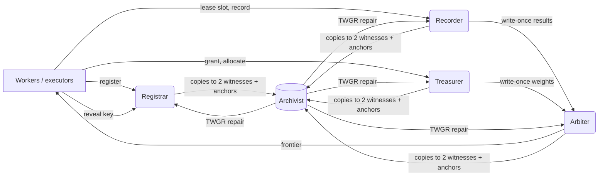

# Stage 7 — QUINTET: Five Coordinators, a Heterogeneous Knowledge-Graph Security Layer, and TWGR Repair

**Request.** Replace the single coordinator with at least five coordinators that have distinct responsibilities. Build a knowledge-graph security layer, as a heterogeneous graph that holds all run data. Recover correct data from other blocks when data is corrupted, with a new algorithm, proofs and ablation graphs. Then test the whole framework as an SQA engineer on simulated devices in a real, controlled environment, using free tools.

**Status of this document.**
- §1–§5 (design, algorithm, proofs) and §6 (hypotheses) were written and committed **before** the Stage 7 experiments ran.
- Results are appended in §8 and §9.
- All coverage claims rest on ground-truth simulation. The real-environment campaign tests the implementation and measures real agent episodes.

---

## 0. Why there was one coordinator, and how five can be safe
The single ledger of Stages 3–6 was not arbitrary. Each statistical invariant needs one serialisation point:
- the error budget (Σ a_j ≤ ε) must not be double-spent;
- a slot must not get two terminal values;
- confirmation must read a well-defined in-order prefix.

QUINTET keeps this property by **partitioning by responsibility, not by data shard**. Every record type has exactly one writer. Everything a coordinator reads from another coordinator is write-once, so a value never changes after it is read. Cross-coordinator reads therefore need no distributed transaction or consensus; this is the CALM argument applied to write-once data (Hellerstein & Alvaro 2020).

What five coordinators buy:
- **Failure isolation:** a crashed Treasurer stops new registrations but not result recording.
- **Load distribution.**
- **Five independent failure domains:** these are what make corruption recoverable.

## 1. Architecture
| Coordinator | Owns (single writer) | Rules enforced |
|---|---|---|
| **Registrar** | Candidate, Key (slot randomness = PRF(κ, j, k), revealed on lease) | R1 |
| **Treasurer** | Lease (budget ε/(n(n+1))), Grant (lease → worker incarnation), Allocation (a_j) | R5 |
| **Recorder** | SlotLease (token, worker), Result (write-once y or crash) | R3, R4 |
| **Arbiter** | Confirmation (e-process decision from the in-order prefix), Frontier (b̂) | R2, R6 |
| **Archivist** | Anchor index over all records, integrity scans, TWGR repair, repair events | corruption tolerance |



## 2. The heterogeneous knowledge graph (HKG)
**Node types (9):** Lease, Grant, Candidate, Allocation, SlotLease, Key, Result, Confirmation, Frontier. Each node is (type, key, payload, owner, edges) and is **write-once**.

**Edge types:** each typed edge stores the **digest of its target**, so every record vouches for its neighbours' content.
| From | Edge | To |
|---|---|---|
| Candidate | funded_by | Lease |
| Allocation | for | Candidate |
| Allocation | funds | Lease |
| Key | of | Candidate |
| SlotLease | for | Candidate |
| Result | for | Candidate |
| Result | key | Key |
| Result | lease | SlotLease |
| Confirmation | weight | Allocation |
| Confirmation | for | Candidate |
| Confirmation | evidence | Result (one edge per consumed result) |
| Frontier | witness | Confirmation |
| Grant | of | Lease |

**Blocks and placement:**
- Each node is stored as bytes at its **owner** and at **two witness domains** chosen by a hash ring over the other four coordinators.
- Its digest is appended to the owner's, both witnesses' (a *receipt*) and the Archivist's **hash-chained anchor logs**.
- *Deviation, recorded before the confirmatory runs:* witness receipts were added after a one-seed pilot showed that losing the owner and Archivist logs left many records with no anchor. The pilot is not reported as a result.

**Three kinds of evidence for every record x:**
- **W1 copies:** the three stored byte copies.
- **W2 anchors:** digests committed at write time in the anchor logs and in the edges of every record that references x.
- **W3 derivations:** recomputations of x from other record types:

| Record | Derived from |
|---|---|
| Lease | its index (budget policy) |
| Allocation | its Candidate and Lease |
| Key | the run key |
| Confirmation | its Allocation and Results |

## 3. TWGR — Typed-Witness Graph Repair (new algorithm)
```
TWGR(stores, params):
  rev  <- reverse edge index from all decodable, id-consistent copies   (edge anchors)
  logs <- anchor entries whose hash chain verifies                       (log anchors)
  ids  <- records attested by an intact copy or by >= 2 failure domains
  accepted <- {}
  for type in [Lease, Grant, Candidate, Allocation, SlotLease, Key, Result, Confirmation, Frontier]:
    for x in ids of this type:
      copies  <- decodable copies of x (any domain)
      items   <- copy digests (candidate values) + anchor digests (votes), each tagged with its domain
      votes   <- for each domain: majority digest among ITS ANCHORS (abstain on tie)   -- copies never vote
      d*      <- plurality digest;  anchored <- d* has a strict majority of domain votes
                                            and >= 2 distinct domains hold evidence for d*
      deriv   <- derive(x, accepted)        -- pure function of already-accepted inputs, or none
      if anchored and some copy has digest d*:        accept copy; heal other copies     (VERIFIED / REPAIRED)
      elif anchored and digest(deriv) = d*:           accept deriv; heal all copies      (RECONSTRUCTED)
      elif not anchored and deriv exists:             accept deriv                        (RECONSTRUCTED)
      else:                                           QUARANTINE x
  Confirmation re-derivation: quarantined results count as Y = 0, and "confirmed" is
  allowed only if every consumed result is present.
  return accepted, statuses
```

**Direction-aware quarantine** (how the consumer treats a quarantined record):
| Quarantined record | Treated as |
|---|---|
| Result | crashed slot (Y = 0 for confirmation, Z = 1 for audits) |
| Allocation or Candidate | unconfirmable |
| Lease | fully spent |
| Confirmation | re-derived conservatively, or absent |

**What is new, and what is reused.**
- **Reused:** hashing, replication, hash-chained logs, majority voting and Merkle-style digest links are all established.
- **New: the combination,** consisting of
  - typed records whose neighbours carry their digests;
  - votes restricted to write-time commitments, one vote per failure domain;
  - exact reconstruction from other record types in dependency order;
  - quarantine rules chosen per record type so that repair can only remove evidence, never add it.
- **New: the proof** that statistical validity survives arbitrary storage corruption under a stated quorum condition (Theorem 2).

We did not find this combination in the literature we surveyed (Stage 1 sources). That is not a claim that no related design exists.

## 4. Proofs
**Setting.**
- **Domains:** D = 5 domains.
- **Honest domain:** a domain is *honest for x* if none of the items it stores that concern x (copies, anchor-log entries, the edges of its copies of x's referencing records) were modified after being written.
- **Random corruption:** bit flips, truncation, deletion, and anchor overwrites with arbitrary digests. These yield digests that coincide with each other or with a true digest only with probability ≤ q²·2⁻¹²⁸ for q stored items (128-bit truncated SHA-256).
- **Adversarial corruption:** an adversary controlling a set B of domains may rewrite anything stored there.

**Lemma 1 (honest votes).** An honest domain that holds any anchor for x votes d(x), the true digest. *Proof:* every anchor it holds was computed from the true x at write time and is unmodified, so its internal majority is d(x). ∎

**Theorem 1 (no fabrication).** Let H(x) be the set of honest anchor-holding domains and B(x) the set of corrupted ones that vote. If |H(x)| > |B(x)| for every record x on which a derivation of x depends, and for x itself, then every record TWGR accepts equals the truth. The exception has probability at most q²·2⁻¹²⁸ under random corruption.

*Proof by induction over the type order.*
- **Anchored acceptance.** The accepted digest d* has a strict majority of votes. By Lemma 1, d(x) receives ≥ |H(x)| votes, and every other digest receives ≤ |B(x)| < |H(x)|. So d* = d(x), and a copy or derivation with digest d(x) equals x by collision resistance.
- **Unanchored acceptance.** This happens only through a derivation, which is a pure function of already-accepted inputs. Those inputs equal the truth by the induction hypothesis, and the writer used the same function. So the derivation equals x byte for byte.
- **Base case.** Lease derivation depends only on public policy.

The random-corruption bound follows because a wrong digest can win only if two corrupted items coincide. ∎

**Remark (tightness).** If |B(x)| ≥ |H(x)| and the adversary writes one consistent wrong value into every domain it controls, TWGR can be made to accept it. This is the optimal resilience of any voting scheme, and experiment E11 measures it. Plain replica-majority voting is weaker: two consistently tampered copies out of three suffice, even when every anchor is honest.

**Theorem 2 (repair preserves statistical validity).** Assume the conditions of Theorem 1 hold. Let 𝒞 be the set of candidates confirmed by the original run and 𝒞′ the set confirmed in the repaired graph. Then 𝒞′ ⊆ 𝒞. Hence P(any false confirmation after repair) ≤ P(any false confirmation in the original run) ≤ ε, by Theorem 1 of the manuscript (sequential validity under R1–R5). The margin can only increase (b̂′ ≥ b̂), which is conservative.

*Proof.* A confirmed record in the repaired graph is accepted in one of two ways.
- **(a) As a stored copy under an anchored majority.** By Theorem 1 it equals the Arbiter's original record.
- **(b) As a re-derivation.** "Confirmed" is permitted only if every consumed result is accepted. Accepted results equal the true results (Theorem 1), and the allocation equals the true a_j. So the re-derivation recomputes the Arbiter's original e-process on identical inputs and reaches the identical decision.

In both cases the candidate was confirmed in the original run. ∎

*Why the guard is needed.* Without it, an adversary who quarantines a chosen subset of results could feed the plug-in betting e-process an outcome sequence it never would have seen. That e-process is not monotone in individual outcomes, so the guard makes Theorem 2 hold even against adversarial deletion.

**Proposition 3 (recovery).** Record x is recovered exactly if three conditions hold:
- (i) the honest anchor domains outnumber the corrupted ones;
- (ii) at least two distinct domains hold evidence for d(x);
- (iii) at least one copy is intact, or x is derivable with all its inputs recovered.

Under independent corruption with probability ρ per stored item, a record with c copies and anchors in m distinct domains fails to be recovered with probability at most

$$
\rho^{c}\,\mathbf 1[\text{not derivable}] \;+\; \Pr\!\big(\mathrm{Bin}(m,\rho) \ge \lceil m/2\rceil\big) \;+\; \Pr(\text{some input not recovered}).
$$

*Proof:* this is the union of the failure events of (i)–(iii), with per-domain independence. ∎

**Proposition 4 (complexity).**
- *Time:* one pass over the S stored items and E edges builds the indices in O(S + E). Each record is then decided in O(c + a_x + δ_x), where a_x is its number of anchors and δ_x its derivation cost; δ = O(cap) for confirmations and O(1) otherwise. Total: O(S + E + J·cap) for J candidates.
- *Space:* O(S + E).

TWGR is one ordered pass followed by one confirmation pass, so no iteration to a fixpoint is needed. Derivations only read already-decided records, and edge votes do not require their source records to be verified.

**Proposition 5 (QUINTET satisfies R1–R6).**
- **R1:** keys are the Registrar's PRF, revealed on lease.
- **R3 and R4:** write-once Results with fencing tokens and crash imputation at the Recorder.
- **R5:** the single Treasurer budget, with the polynomial lease schedule.
- **R2 and R6:** the Arbiter computes from committed prefixes and stored records.

Each rule's state has exactly one writer, and cross-coordinator reads touch only write-once records. So the per-owner linearizable implementations compose without coordination, and the manuscript's validity theorems apply. ∎

## 5. Threat model of the security layer
**Covered:**
- random storage corruption of any kind and at any rate;
- crash and loss of whole domains, as long as a majority of anchor domains survives for each record;
- an adversary controlling a minority of the anchor domains of a record.

**Not covered:**
- an adversary controlling a majority of a record's anchor domains (Theorem 1 is tight);
- compromise of the run key κ;
- corruption of the executor's *observation* before it is recorded. That is oracle integrity, not storage integrity.

## 6. Preregistered hypotheses (fixed before the Stage 7 runs)
**Synthetic corruption study (E10).**
- Each run: a QUINTET run with 4 workers and 2,000 oracle calls.
- Corruption rates: ρ ∈ {0.01, 0.05, 0.1, 0.2, 0.3, 0.45, 0.6}, applied independently to every stored item, with kinds {bitflip, truncate, delete, tamper}.
- Scenarios: S1-moderate (for power) and boundary-null (for validity).
- 40 runs per (variant, ρ, scenario).

**Variants:**

| Variant | What it removes or replaces |
|---|---|
| TWGR (full) | — |
| −replicas | witness copies are not read |
| −log anchors | — |
| −edge anchors | — |
| −derivation | — |
| item votes | votes counted per item, not per domain |
| replica-majority | plain voting over copies; no anchors or derivations |
| best-effort | no quarantine: take the owner copy, else any copy |
| single-coordinator checksum | one domain, no replicas; it can detect corruption against its own log but cannot repair |

**Adversarial study (E11).** Consistent tamper of a Result's value in k ∈ {1, …, 5} domains.

| ID | Hypothesis | Criterion |
|---|---|---|
| H7-safe | TWGR accepts no wrong non-confirmation record and adds no confirmation | 0 wrong records and 0 added confirmations in every E10 run, all ρ |
| H7-recover | TWGR recovers almost all records at moderate corruption | mean exact-recovery ≥ 0.99 at ρ ≤ 0.1 and ≥ 0.90 at ρ = 0.3 |
| H7-ablate | Each evidence source matters | every single-component removal lowers mean recovery at ρ = 0.3 (bootstrap CI of the difference excludes 0), or introduces wrong records |
| H7-baselines | Common alternatives are unsafe or weak | replica-majority accepts wrong records at ρ ≥ 0.1; best-effort raises boundary-null false confirmation above ε at ρ ≥ 0.1; single-coordinator recovery is ≤ 0.5 at ρ = 0.3 |
| H7-validity | Repair keeps validity | boundary-null false-confirmation rate after TWGR ≤ ε (Wilson lower bound) at every ρ |
| H7-power | Repair keeps the margin | b̂ = k* in ≥ 90% of S1 runs at ρ ≤ 0.2 |
| H7-adversary | The quorum bound is exact | wrong acceptance never occurs while compromised anchor domains are a minority, and does occur once they are a majority |

**Real controlled environment (E12, SQA campaign) and real agents (E13).**
- **E12:** test cases with pass/fail criteria are fixed in `realenv/TEST_PLAN.md` before execution.
- **E13:** a descriptive measurement of real AgentDojo episodes on a free local LLM. It has no directional hypothesis. It reports latency and timeout rates by outcome, and the false-confirmation inflation those rates imply.

## 7. Implementation
- `fresco/hkg/graph.py`: nodes, digests, domain stores, persistence, placement.
- `fresco/hkg/repair.py`: TWGR, derivations, quarantine.
- `fresco/hkg/corrupt.py`: the corruption injector.
- `fresco/quintet/cluster.py`: the five coordinators, in process.
- `fresco/quintet/service.py`: the networked services (Stage 7, §9).
- `tests/test_hkg_quintet.py`: 15 tests, covering repair, healing, reconstruction, quarantine, the minority-adversary bound, the failure of the replica-majority and best-effort baselines, the subset property of confirmations, phantom-id rejection, persistence with corrupted lines, and the single-writer-per-type property.

## 8. Results — synthetic corruption study (E10, E11)
**Sources.** Full tables are in `results/processed/stage7_summary.md`, generated by `analysis/stage7_figures.py` from `results/raw/e10_corruption.jsonl` and `e11_adversary.jsonl`. Figures are `figures/fig10_corruption.png`, `fig11_ablation.png`, `fig12_domain_loss.png` and `fig13_adversary.png`.

**E10 setup.** 80 QUINTET runs (40 S1-dense, 40 boundary-null), about 9,300 records each. The corruption rates ρ ∈ {0, 0.01, 0.05, 0.1, 0.2, 0.3, 0.45, 0.6} were applied to every stored item (node copies and anchor-log entries). There were 10 variants, all repairing the identical corrupted stores.

**Safety.**
- Full TWGR accepted **0 wrong records and added 0 confirmations, with 0 phantom records, over 640 repairs**, including ρ = 0.6. No boundary-null run had a false confirmation after repair (0/40 at every ρ).
- Every ablation of TWGR was equally safe.
- The two common alternatives were not safe:
  - *Replica-majority* accepted 21 wrong records at ρ = 0.01 and 114,568 at ρ = 0.6 (totals over 80 runs). It produced false confirmations in 6/40 boundary-null runs at ρ = 0.1, 20/40 at ρ = 0.2 and 40/40 from ρ = 0.45.
  - *Best-effort* (take the owner copy) produced false confirmations in 6/40 runs at ρ = 0.01 and 32/40 at ρ = 0.1.

**Recovery.** Mean fraction of records recovered with exactly their original bytes:

| ρ | 0.05 | 0.1 | 0.2 | 0.3 | 0.6 |
|---|---|---|---|---|---|
| TWGR | 0.9999 | 0.9993 | 0.9940 | 0.9788 | 0.8036 |
| Single coordinator (one copy plus a checksum log) | 0.873 | 0.758 | 0.555 | 0.394 | 0.097 |

The single coordinator is safe but cannot repair.

**Ablation at ρ = 0.3** (paired differences in recovery, 95% bootstrap CI):

| Removed | Recovery lost |
|---|---|
| witness replicas | 0.215 [0.213, 0.216] |
| edge anchors | 0.049 |
| log anchors | 0.031 |
| derivation | 0.0099 [0.0097, 0.0101] |

Counting votes per item instead of per domain made no difference under random corruption (Δ = −0.0001). **H7-ablate is therefore not supported as preregistered.** Per-domain voting matters only against an adversary, which is what E11 tests.

**Whole-domain loss.**

| Domains erased | TWGR | TWGR with support 1 | Replica-majority |
|---|---|---|---|
| 1 | 1.000 | 1.000 | 1.000 |
| 2 | 0.975 | 1.000 | 1.000 |
| 3 | 0.754 | 0.910 | 0.897 |

None of the three accepted a wrong record. The two-domain support rule costs availability when domains are lost. Requiring support from one domain (an exploratory variant, not preregistered) removes that cost, and it had 0 wrong records in E10 as well. However, Theorem 1 does not need the rule, and E11 did not test the variant.

**E11 (coordinated adversary; 1,800 attacks).**
- Full TWGR accepted a wrong value in **0 of 810 attacks where the compromised domains were at most half of the target's anchor domains**, and in all 990 attacks where they were a strict majority. This is exactly the bound of Theorem 1 and its tightness remark.
- In the 2b = m tie cases, TWGR quarantined the record (114 attacks).
- Replica-majority accepted the wrong value in 134 attacks with a minority adversary, all with b = 2.

**Preregistered verdicts:**

| Hypothesis | Verdict |
|---|---|
| H7-safe | supported |
| H7-recover | supported |
| H7-ablate | **not supported** (domain votes ≈ item votes under random corruption) |
| H7-baselines | supported, all three parts |
| H7-validity | supported |
| H7-power | supported (b̂ = k* in 100% of S1 runs at ρ ≤ 0.2) |
| H7-adversary | supported |

## 9. Results — real controlled environment (E12) and real agents (E13)
**E12.** The full report is in `realenv/RESULTS.md`.
- The final campaign run passed 19 of 21 test cases, and no storage-fault case accepted a wrong record.
- The two failures:
  - a power miss in TC1 (b̂ = 4);
  - a convergence criterion at ρ = 0.4, where the second scan recovered one more record.
- The campaign found **seven defects in the networked service (D1–D7)**, and all are fixed. Four were integrity defects, and all four share one root cause: *a coordinator trusted its own local storage after a fault*. They led to the **repair-before-serve** and **anchor-verified reads** principles. None of these defects was in TWGR.

**E13.** See the manuscript's real-agent section and `results/processed/stage7_summary.md`.
